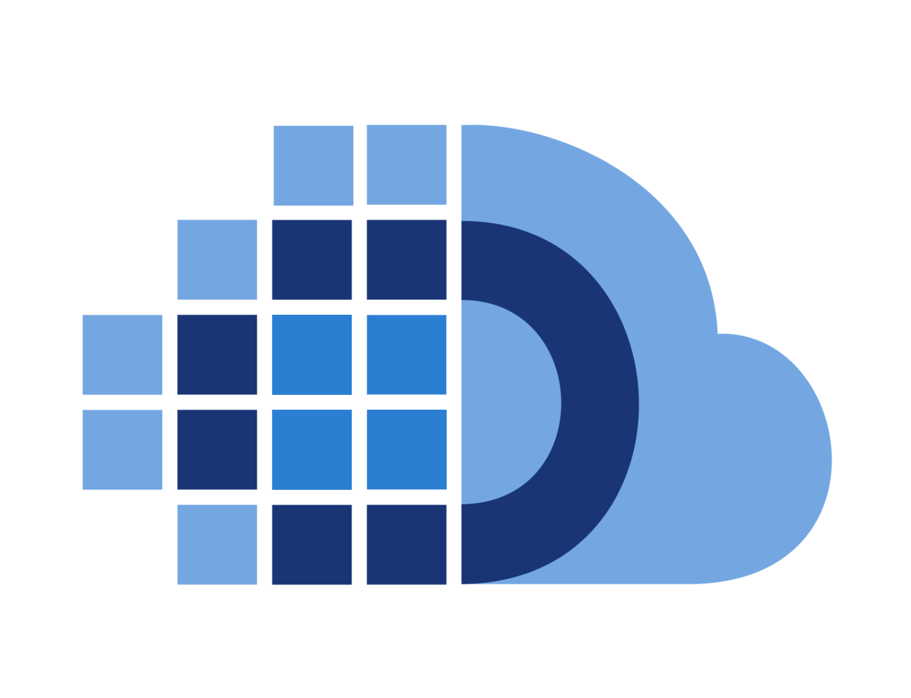

CusDeb OS is a **Win32/Linux** operating system—or, in other words, a Windows-like operating system with a **Win32** userland built on the solid foundation of the **Linux** kernel. It offers a *classic desktop experience* with the *ability to run Windows applications*, making it feel familiar to users whose computing habits were shaped in the **pre-Windows 11** era. But there are things CusDeb OS deliberately refuses to imitate, remaining *predictable*, *stable*, and *ad-free*.

  

## Table of Contents

* [Features](#features)
* [Installing](#installing)
* [Licensing](#licensing)
* [Donate](#donate)

## Features

* Windows-like desktop environment based on [CDEX](https://github.com/cusdeb-com/os/tree/main/core/cdex), providing a classic desktop experience.
* Entire desktop environment and accompanying applications are **Win32**-based.
* Seamless support for **Windows** applications through [Wine](https://winehq.org).
* **Direct3D** 3–11 support through [D7VK](https://github.com/WinterSnowfall/d7vk) and [DXVK](https://github.com/doitsujin/dxvk/) (*planned for post-alpha releases*).
* Native **Linux** application support.
* Built on [Debian](https://debian.org).

## Installing

You can find the latest CusDeb OS live images [here](https://github.com/cusdeb-com/os/releases).

## Authors

See [AUTHORS](AUTHORS.md).

## Licensing

CusDeb OS consists of components distributed under different licenses.

Components originally developed for CusDeb OS are licensed under the [Apache License 2.0](https://github.com/cusdeb-com/os/blob/main/LICENSE).

Third-party components are debianized, and their licenses are meticulously documented in the `debian/copyright` files accompanying each package, following Debian packaging conventions. For example, see the copyright files for [CDEX](https://github.com/cusdeb-com/os/blob/main/core/cdex/debian/copyright) and [Wine](https://github.com/cusdeb-com/os/blob/main/core/wine/debian/copyright).

The default desktop wallpaper is licensed under [Creative Commons Attribution-ShareAlike 4.0 International](https://creativecommons.org/licenses/by-sa/4.0/) (CC BY-SA 4.0) and created by [Natalia Endaltseva](https://instagram.com/artbooknat).

## Donate

The best way to support the project is by subscribing to the technical magazine [CDMAG](https://cusdeb.com/cdmag).

CDMAG covers operating system internals, Linux development, and the open source ecosystem.
